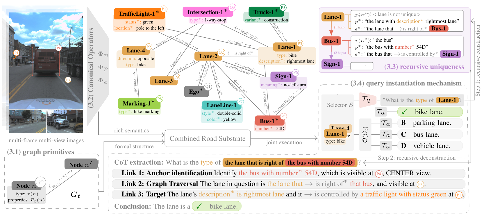
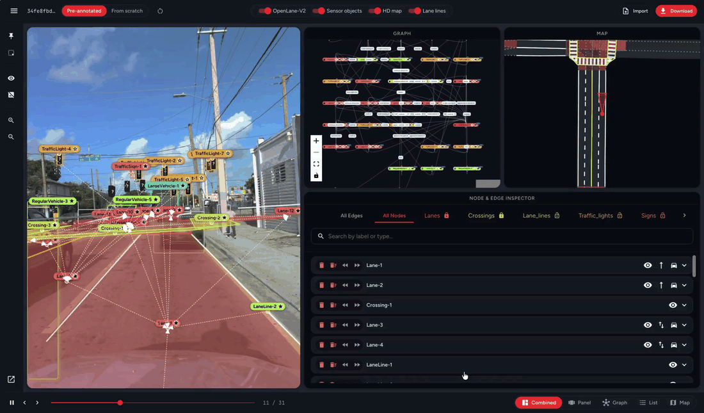

<div align="center">

# Bridging Structure and Language: Graph-Based Visual Reasoning for Autonomous Road Understanding

**NeurIPS 2026**

[Lena Wild](https://lwildd.github.io)<sup>1,2</sup>  [Katie Z. Luo](https://katieluo88.github.io/)<sup>3,4</sup>  [Marco Pavone](https://stanford.edu/~pavone/)<sup>3,5</sup>

<sup>1</sup>KTH Royal Institute of Technology&nbsp;&nbsp;&nbsp;&nbsp;<sup>2</sup>TRATON&nbsp;&nbsp;&nbsp;&nbsp;<sup>3</sup>Stanford University&nbsp;&nbsp;&nbsp;&nbsp;<sup>4</sup>Waymo&nbsp;&nbsp;&nbsp;&nbsp;<sup>5</sup>NVIDIA

[](https://arxiv.org/abs/2605.20942)
[](https://kth-rpl.github.io/CRS/)
[](https://kth-rpl.github.io/CRS/annotator/)

</div>

**TL;DR** We introduce the **Combined Road Substrate (CRS)**, a scene graph that makes road structure and open-vocabulary semantics executable in one representation. Recursive queries over it generate grounded multiple-choice questions with verifiable chain-of-thought. Fine-tuning a 2B or 4B vision-language model on as few as 20 to 80 CRS scenes gives large, stable gains in structured road reasoning.

<p align="center">
  
  <br>
  <sub>Overview of CRS, see the <a href="https://arxiv.org/abs/2605.20942">paper</a> for details</sub>
</p>

## Overview

This repository contains four parts:
1. **Graph creation and annotations:** the details on where to find the graph creation toolkit and our annotated CRS scene graphs.
2. **Question-answer generation:** the pipeline that generates multiple-choice question–answer data from the annotated scene graphs.
3. **Fine-tuning Qwen3-VL:** the training recipe for the models in the paper.
4. **Evaluation on MapVQA:** inference and scoring on the MapVQA validation benchmark.

## Contents

- [1. Graph creation, annotations and source data](#1-graph-creation-annotations-and-source-data)
- [2. Question-answer generation](#2-question-answer-generation)
- [3. Fine-tuning Qwen3-VL](#3-fine-tuning-qwen3-vl)
- [4. Evaluation on MapVQA](#4-evaluation-on-mapvqa)
- [Citation](#citation)

## 1. Graph creation, annotations and source data

For image data, download the [Argoverse 2 Sensor dataset](https://www.argoverse.org/av2.html). In addition, we provide the following: 
| Path | Content |
|---|---|
| `data/annotations/` | One annotated scene graph per log (nodes, properties, relations per frame) |
| `data/metadata/` | Preprocessed OpenLane-V2 metadata per log (camera timestamps, calibration, poses, map geometry) |
| `data/validation.json` | The MapVQA validation benchmark: 1,014 manually reviewed questions from held-out logs |

The annotations and metadata cover the 80 training logs. Training and validation logs are geographically disjoint: the training logs are from the train split, the validation logs from the val and test splits of the near-extrapolation geographical splits of
[Lilja et al. (2024)](https://github.com/LiljaAdam/geographical-splits).

We provide our annotations, which were created with our graph creator, a web tool for annotating scene graphs on Argoverse 2 logs. It is publicly available and allows to inspect our annotations or create your own.

<p align="center">
  <a href="https://kth-rpl.github.io/CRS/annotator/"></a>
  <br>
</p>
<p align="center">
  
<sub>Our graph creation tool, try at <a href="https://kth-rpl.github.io/CRS/annotator/">kth-rpl.github.io/CRS/annotator</a></sub>
</p>


## 2. Question-answer generation
Requires Python ≥ 3.11.

```bash
pip install -r requirements.txt
```

This is enough for data generation and scoring. Training and inference need their own environments, described in their sections.
```bash
python qa_generation/generate.py --format answer --out out/mapvqa_train_answer.json   # answer only
python qa_generation/generate.py --format rcot   --out out/mapvqa_train_rcot.json     # answer + reasoning (CoT model)
```

The prompt is the same for all formats. The paper's models are trained on `answer`
(SFT) and `rcot` (CoT). The dataset can also be generated in forward-CoT version, but we found this to give worse results.
Output is a JSON list in the Qwen-VL conversation format:

```json
{
  "type": "lane_direction",
  "image": ["<logid>/sensors/cameras/ring_front_left/<ts>.jpg", "..."],
  "conversations": [
    {"from": "human", "value": "Frame 0 (LEFT): <image>\n...\nQuestion:\n...\n\nAnswers:\nA. ...\nB. ..."},
    {"from": "gpt", "value": "Reasoning:\n...\n\nANSWER: B"}
  ]
}
```

Objects referred to by position appear as `point_<i>` in the question, with grounding
boxes or points (0–1000 normalized coordinates) attached to the images of the last frame.
The pipeline generates the following QA types:

| Type | Question about |
|---|---|
| `lane_direction` | Direction of a lane |
| `lane_type` | Type of a lane (standard travel, bike, bus, street parking, …) |
| `line_marking`, `line_type`, `line_color` | Left or right lane line of a lane: full marking, type only, colour only |
| `existence_crossings` | Whether there is a pedestrian crossing on a given side of the intersection, and how it is marked |
| `pc_type` | Marking style of a pedestrian crossing |
| `counting_off_intersection_generic` | Number of lanes in one direction |
| `counting_off_intersection_direction` | Number of lanes, split by direction |
| `counting_at_intersection_direction` | Number of lanes on one road at the intersection, split by direction |
| `counting_off_crossing` | Number of pedestrian crossings |
| `traffic_lights` | Current status of a traffic light |
| `traffic_light_change` | Whether a traffic light changed status over the last 4 frames |
| `tl_lane_controls` | Number of lanes a traffic light controls |
| `sign_lane_controls` | Which lane(s) a sign controls |
| `vehicle_position` | Which lane a vehicle (or the ego) is in |
| `pairwise_vehicle_location` | Whether two vehicles are in the same lane |
| `pairwise_lane_comparison_direction` | Whether two lanes share the same direction |
| `pointing` | Where an object is |


## 3. Fine-tuning Qwen3-VL

The models in the paper are standard supervised fine-tunes of **Qwen3-VL-2B-Instruct**
and **Qwen3-VL-4B-Instruct** with the official fine-tuning code of
[QwenLM/Qwen3-VL](https://github.com/QwenLM/Qwen3-VL), without modifications.

Set up the fine-tuning code (install its requirements as described in its README):

```bash
git clone https://github.com/QwenLM/Qwen3-VL.git
cd Qwen3-VL
git checkout 5df61e0b73d7862ae2bab61e3e8c2cea93da28fb   # version used in the paper
cd qwen-vl-finetune
```

Register the generated files in `qwenvl/data/__init__.py`, with `data_path` pointing to
the Argoverse 2 Sensor `train` split:

```python
MAPVQA_TRAIN_ANSWER = {
    "annotation_path": "/path/to/MapVQA/out/mapvqa_train_answer.json",
    "data_path": "/path/to/argoverse2/sensor/train",
}
MAPVQA_TRAIN_RCOT = {
    "annotation_path": "/path/to/MapVQA/out/mapvqa_train_rcot.json",
    "data_path": "/path/to/argoverse2/sensor/train",
}

data_dict = {
    # ... 
    "mapvqa_train_answer": MAPVQA_TRAIN_ANSWER,
    "mapvqa_train_rcot": MAPVQA_TRAIN_RCOT,
}
```

Train from `Qwen3-VL/qwen-vl-finetune`:

```bash
LR=4e-5 bash /path/to/MapVQA/training/train.sh mapvqa_train_answer Qwen/Qwen3-VL-4B-Instruct
LR=9e-5 bash /path/to/MapVQA/training/train.sh mapvqa_train_rcot Qwen/Qwen3-VL-4B-Instruct
```


## 4. Evaluation on MapVQA

Inference uses vLLM; install it in a separate environment if its `transformers`
version conflicts with the training setup:

```bash
# Predictions (greedy decoding, up to 6144 new tokens)
python evaluation/predict.py \
    --model /path/to/checkpoint \
    --questions data/validation.json \
    --image_root /path/to/argoverse2/sensor/train \
    --out results/predictions.jsonl

# Accuracy, overall and per question type
python evaluation/score.py \
    --predictions results/predictions.jsonl \
    --questions data/validation.json \
    --out results/scores.json
```

The predicted letter is read from `ANSWER: X`. For models not trained on this format,
`score.py` falls back to a bare letter, a leading `X.`, or a single option letter in the
text. Predictions without a readable letter count as wrong.


## Citation

```bibtex
@inproceedings{wild2026bridging,
  title     = {Bridging Structure and Language: Graph-Based Visual Reasoning for Autonomous Road Understanding},
  author    = {Wild, Lena and Luo, Katie Z. and Pavone, Marco},
  booktitle = {Advances in Neural Information Processing Systems (NeurIPS)},
  year      = {2026}
}
```

## License

The code in this repository is released under the [MIT License](LICENSE).

The annotations, metadata and MapVQA benchmark in `data/` are derived from
[Argoverse 2](https://www.argoverse.org/av2.html) and
[OpenLane-V2](https://github.com/OpenDriveLab/OpenLane-V2) and are released under
[CC BY-NC-SA 4.0](https://creativecommons.org/licenses/by-nc-sa/4.0/). The images are not
included; their use is subject to the Argoverse 2 terms of use.
